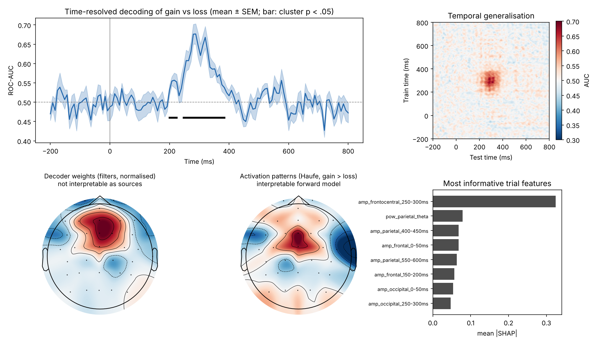

# eeg-decoding-xai

Multivariate decoding of **reward feedback (gain vs loss)** from single-trial EEG, with a focus on **interpretability**: what the models use, when, and where on the scalp, and which of those explanations can be read neurophysiologically.



## Analyses

1. **Time-resolved decoding.** A cross-validated logistic-regression classifier at each time point (ROC-AUC), followed by a group-level cluster-based permutation test against chance. It shows *when* gain and loss trials become distinguishable. In the demo, decoding rises above chance around 200 ms and peaks near 300 ms, the RewP window.
2. **Temporal generalisation.** Train at time *t*, test at *t′*. A compact diagonal blob indicates a transient code, while a square indicates a sustained one.
3. **Filters vs activation patterns.** The weights of a linear decoder (*filters*) partly reflect noise suppression and are not maps of where the signal originates. They are converted into forward-model **activation patterns** (Haufe et al., 2014), A = Cov(X)·w, which can be interpreted. The figure shows both side by side.
4. **Feature-level explanations of a non-linear model.** Trials are summarised into interpretable features (mean amplitude per ROI in 50 ms windows; theta and alpha power per ROI), z-scored within participant, and classified with gradient boosting. The model is explained with permutation importance on held-out data and with SHAP values.

## What the demo shows

- Multivariate decoding across 32 channels reaches a peak AUC of about 0.7 in the RewP window, whereas the pooled ROI-feature model reaches about 0.58. Single-trial reward signals are weak, and a spatial filter can exploit information across all channels that ROI averaging discards.
- The activation pattern is fronto-central, matching the simulated RewP generator; the most important SHAP feature is fronto-central amplitude at 250–300 ms.
- SHAP and permutation importance describe **the model**, not the brain. Correlated features share credit, so explanations are cross-checked against activation patterns and prior literature before being interpreted.

## Quick start

```bash
pip install -r requirements.txt
python run_decoding.py --n-subjects 8
pytest -q
```

Outputs in `results/`: `time_resolved_auc.csv`, `permutation_importance.csv`, `shap_importance.csv` and `decoding_xai.png`.

## Synthetic data

`eegxai.simulate` (shared with the companion repository `eeg-reward-positivity`) produces 32-channel gambling-task EEG with 1/f background activity, alpha, line noise, eye blinks, independent sensor noise and a feedback-locked RewP. Independent sensor noise is included deliberately: with only spatially correlated noise, a linear spatial filter can cancel it almost completely and single-trial decoding becomes unrealistically easy. Results are a validation of the code, not a finding.

## References

- Haufe, S., et al. (2014). On the interpretation of weight vectors of linear models in multivariate neuroimaging. *NeuroImage*, 87, 96–110.
- King, J.-R., & Dehaene, S. (2014). Characterizing the dynamics of mental representations: the temporal generalization method. *Trends in Cognitive Sciences*, 18(4), 203–210.
- Lundberg, S. M., & Lee, S.-I. (2017). A unified approach to interpreting model predictions. *Advances in Neural Information Processing Systems*, 30.

## Author

Cristian Godoy Martínez · MIT License
